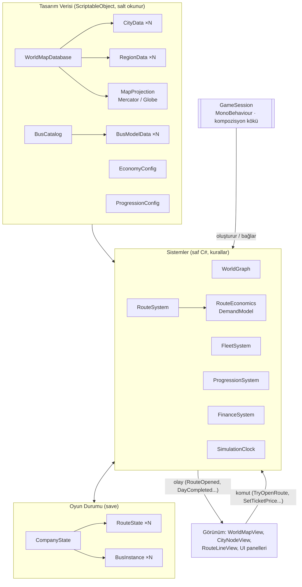
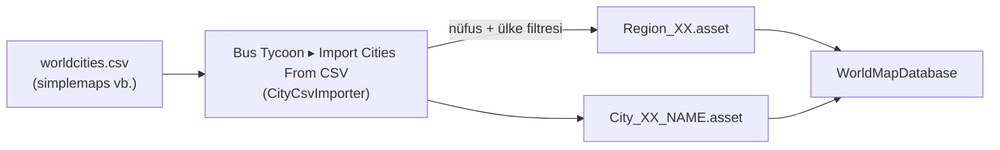

# 1 · Mimari ve Gerçek Dünya Haritası / Şehir (Node) Sistemi

Bu doküman oyunun genel mimarisini ve harita katmanını anlatır. Kodun tamamı
`Assets/_Project/Scripts/` altında, ilgili sınıf adları her başlıkta verilmiştir.

---

## 1.1 Temel ilke: Tasarım verisi ≠ Oyun durumu

| | **Tasarım verisi** | **Oyun durumu (save)** |
|---|---|---|
| Nerede? | `ScriptableObject` asset'leri | Saf C# `[Serializable]` sınıflar |
| Örnek | `CityData`, `BusModelData`, `EconomyConfig` | `CompanyState`, `RouteState`, `BusInstance` |
| Oyun sırasında değişir mi? | **Asla** | Her gün |
| Kayda yazılır mı? | Hayır | Evet (JSON) |
| Birbirine nasıl bağlanır? | — | Yalnızca **kalıcı kimlikle** (`cityId`, `modelId`, `regionId`) |

Bu ayrım sayesinde:
* Tasarımcı bir şehrin nüfusunu veya bir otobüsün fiyatını değiştirdiğinde eski kayıtlar bozulmaz.
* Kayıt dosyasında asset GUID'i veya Unity referansı bulunmaz; `JsonUtility` ile sorunsuz serileşir.
* Ekonomi kuralları saf C# olduğu için Unity açılmadan birim testi yazılabilir (`Tests/EditMode`).

---

## 1.2 Katmanlı mimari



* **`GameSession`** sahnedeki tek "beyin" MonoBehaviour'dur. Tüm sistemleri oluşturur, birbirine
  enjekte eder, saati tick'ler ve günlük simülasyonu sıralar.
* **Sistemler** birbirine yalnızca tek yönde bağımlıdır (döngü yok):
  `Finance ← Progression ← Fleet ← Routes`.
* **Görünüm katmanı** (`BusTycoon.Presentation` assembly) hiçbir kural içermez; sadece komut gönderir
  ve olay dinler. UI'ı uGUI yerine UI Toolkit ile yeniden yazmak çekirdeğe dokunmayı gerektirmez.

### Assembly Definition'lar

| Assembly | İçerik | Bağımlılık |
|---|---|---|
| `BusTycoon.Runtime` | Data, World, Economy, Routes, Fleet, Progression, Save, Core | Yalnız UnityEngine |
| `BusTycoon.Presentation` | Harita görünümü + UI | Runtime, uGUI, TextMeshPro, (opsiyonel) Input System |
| `BusTycoon.Editor` | CSV içe aktarıcı, varsayılan içerik | Runtime (yalnız Editor) |
| `BusTycoon.Tests.EditMode` | NUnit testleri | Runtime |

### Klasör yapısı

```
Assets/_Project/
├─ Resources/BusTycoon/      cities.csv (93 şehir) + map.png — oyun Play'de bunlardan kendini kurar
├─ Data/                      ← (opsiyonel) "Create Default Content" ile üretilen düzenlenebilir asset'ler
│  ├─ Config/                 EconomyConfig, ProgressionConfig
│  ├─ Fleet/                  Bus_*.asset, BusCatalog
│  └─ World/                  WorldMapDatabase, MercatorProjection, Regions/, Cities/TR/ ...
├─ Scripts/
│  ├─ Runtime/
│  │  ├─ Core/                GameSession, SimulationClock, OpResult
│  │  ├─ Data/                ScriptableObject tanımları
│  │  ├─ World/               GeoCoordinate, MapProjection(+Mercator/Globe), WorldGraph
│  │  ├─ Economy/             DemandModel, RouteEconomics, PriceOptimizer, PricingAdvisor, FinanceSystem
│  │  ├─ Routes/              RouteState, RouteSystem, RouteAdvisor
│  │  ├─ Fleet/               BusInstance, FleetSystem
│  │  ├─ Progression/         ProgressionSystem
│  │  └─ Save/                CompanyState, SaveSystem
│  ├─ Game/                   OYNANABİLİR KATMAN: GameBootstrap, WorldRenderer, MapCamera, GoalTracker, UI/GameUI (IMGUI)
│  ├─ Presentation/           opsiyonel uGUI + prefab yolu
│  │  ├─ Map/                 WorldMapView, CityNodeView, RouteLineView
│  │  └─ UI/                  UIFlowController, HudView, TicketPricePanel, RoutePlannerController, ...
│  └─ Editor/                 CityCsvImporter, DefaultContentCreator
└─ Tests/EditMode/            DemandModelTests, EconomySystemsTests
```

---

## 1.3 Gerçek dünya koordinatları

### `GeoCoordinate` (struct)
Enlem/boylamı **double** olarak tutar (WGS84 derece). Unity dünya pozisyonu hiçbir zaman kaydedilmez;
her zaman projeksiyondan türetilir. Böylece harita görselini değiştirmek (ör. düz haritadan küreye geçmek)
hiçbir şehir verisine dokunmayı gerektirmez.

* `HaversineKm(a, b)` – kuş uçuşu (büyük daire) mesafe. İstanbul–Ankara ≈ **349 km** (testte doğrulanır).
* `Interpolate(a, b, t)` – büyük daire üzerinde ara nokta; hat çizgilerini (yay) örneklemek için.

### Projeksiyonlar (`MapProjection` → ScriptableObject)

| Sınıf | Kullanım | Not |
|---|---|---|
| `MercatorMapProjection` | XZ düzleminde düz 3D harita (önerilen) | Enlem/boylam sınırları harita dokusuyla **birebir** aynı olmalı. Yükseklik en-boy oranından otomatik hesaplanır. |
| `GlobeMapProjection` | 3D dünya küresi | Kıtalar arası genişleme veya ana menü için. |

Projeksiyon bir asset olduğu için `WorldMapDatabase` üzerindeki referansı değiştirmek haritanın türünü değiştirir.
Varsayılan içerik Türkiye + Balkanlar + Kafkasya'yı kapsar: boylam 19°–47°, enlem 34°–45°.

---

## 1.4 Şehir düğümü: `CityData`

| Alan | Açıklama | Oyundaki etkisi |
|---|---|---|
| `cityId` | Kalıcı kimlik, ör. `TR_ISTANBUL` | Kayıtlar bu kimliği saklar; **yayından sonra değiştirmeyin** |
| `displayName` | Görünen ad (UTF-8: İstanbul, Şanlıurfa) | UI |
| `region` | `RegionData` referansı | Bölgesel çarpanlar + genişleme kilidi |
| `coordinate` | `GeoCoordinate` | Mesafe ve harita konumu |
| `population` | Metropol nüfusu | **Çekim (gravity) talep modelinin ana girdisi** |
| `tourismIndex` | 0.5–2 (Antalya 1.5, Nevşehir 1.45) | Talep çarpanı |
| `isCapital` | Başkent | Etiket vurgusu |
| `landmassOverride` | Ada şehirleri için (ör. `crete`) | Bağlanabilirlik |
| `terminalFeeOverride` | <0 ise nüfusa göre otomatik | Sefer başı otogar ücreti |
| `landmarkPrefab` | Opsiyonel 3D simge yapı | Görsel |

Hesaplanan yardımcılar:
* `MapTier` – 0 (≥3 M metropol) … 3 (<300 B). Harita LOD'u ve etiket görünürlüğü için.
* `GetTerminalFee(cfg)` = `taban + k × √(nüfus_milyon)` → İstanbul ≈ 7,9 $, küçük şehir ≈ 2,8 $.

## 1.5 Bölge: `RegionData`

Ülke (veya istenirse eyalet) seviyesinde:
* **Ekonomi çarpanları**: `fareMultiplier` (alım gücü → referans bilet fiyatı), `fuelPriceMultiplier`, `wageMultiplier`.
* **Genişleme kilidi**: `requiredCompanyLevel` + `operatingLicenseCost`. Başlangıç şehrinin bölgesi ücretsiz açılır.
* `defaultLandmassId`: karayolu bağlantısı olan kara kütlesi.

Örnek içerik:

| Bölge | Bilet× | Yakıt× | Maaş× | Gerekli seviye | Lisans |
|---|---|---|---|---|---|
| TR Türkiye | 1.00 | 1.00 | 1.00 | 1 | 50.000 $ (başlangıçta ücretsiz) |
| BG Bulgaristan | 1.10 | 1.05 | 1.30 | 6 | 25.000 $ |
| GE Gürcistan | 0.80 | 0.90 | 0.70 | 7 | 30.000 $ |
| GR Yunanistan | 1.40 | 1.30 | 1.80 | 9 | 60.000 $ |
| RO Romanya | 1.10 | 1.10 | 1.40 | 11 | 70.000 $ |

## 1.6 `WorldMapDatabase` ve `WorldGraph`

`WorldMapDatabase` (asset) haritanın tek giriş noktasıdır: projeksiyon, bölge listesi, şehir listesi ve yol kuralları.
Runtime'da bundan saf C# bir **`WorldGraph`** inşa edilir (sözlük tabanlı hızlı sorgular):

| Metot | Ne yapar |
|---|---|
| `GetCity(id)` / `GetRegion(id)` | O(1) kimlik araması (kayıt yüklerken kullanılır) |
| `GetRoadDistanceKm(a, b)` | Elle girilmiş gerçek mesafe **veya** `Haversine × roadCircuityFactor (1.25)` |
| `CanConnect(a, b, out reason)` | Aynı şehir, kapalı yol, farklı kara kütlesi, min/max mesafe kontrolü |
| `GetCitiesWithinKm(origin, km, list)` | Yakın şehirler (başlangıç ekranı zorluk ipucu, öneriler) |

**Neden graf (yol ağı) değil de "nokta-nokta"?** Otobüs işletmeciliğinde oyuncunun kararı "hangi iki şehri
bağlayayım?" sorusudur; aradaki karayolu güzergâhı bir oyun kararı değildir. Bu yüzden mesafe
`dolambaç katsayısı` ile tahmin edilir, kritik çiftler için `RoadDistanceOverride` ile gerçek değer girilir.
İleride gerçek yol ağı isterseniz OSRM/Valhalla ile önceden hesaplanmış bir **mesafe matrisi CSV'si**
`roadOverrides` listesine aktarılabilir — runtime kodu değişmez.

`RoadDistanceOverride.blocked = true` ile sınır kapısı olmayan çiftler kapatılır; `LandmassLink` ile feribot
bağlantıları (ör. `eurasia ↔ crete`) açılır.

---

## 1.7 Gerçek dünya verisini içe aktarma (CSV pipeline)



* simplemaps `worldcities.csv` biçimini doğrudan okur (`city, lat, lng, country, iso2, population, capital`).
  İsteğe bağlı ek sütunlar: `tourism`, `landmass`.
* Kimlik üretimi Türkçe karakterleri dönüştürür: `Şanlıurfa → TR_SANLIURFA`. Aynı ülkede aynı adlı şehirlere `_2` eklenir.
* Var olan asset **güncellenir** (GUID korunur) → yeniden içe aktarmak sahne referanslarını kırmaz.
* Oyunla gelen veri: `Assets/_Project/Resources/BusTycoon/cities.csv` — 81 il (GeoNames il merkezi koordinatı + il nüfusu)
  ve 12 komşu ülke şehri. `Tools/build_world_data.py` bu dosyayı ve Natural Earth sınırlarından `map.png` harita
  dokusunu üretir; sınırlar `DefaultContent.cs` içindeki `MinLongitude…MaxLatitude` ile aynı olmalıdır.
* Çalışma anında `DefaultContent.Build(csv)` tüm ScriptableObject'leri bellekte oluşturur (asset gerekmez).

### Ölçek önerisi
| Senaryo | Şehir sayısı | Filtre |
|---|---|---|
| Türkiye kampanyası | 81 il merkezi | `TR`, nüfus ≥ 0 |
| Avrupa + Orta Doğu | ~400–600 | nüfus ≥ 250.000 |
| Tüm dünya | ~1.500–3.000 | nüfus ≥ 500.000 |

Binlerce şehir için: `WorldMapView.maxSpawnTier` ile küçük şehirleri uzak zoom'da oluşturmayın,
işaretçi materyalinde **GPU Instancing** açın, etiketleri `SetLabelTier(zoomLevel)` ile zoom'a bağlayın.

---

## 1.8 Harita görünümü (Presentation)

| Sınıf | Görev |
|---|---|
| `WorldMapView` | Şehir düğümlerini ve hat çizgilerini oluşturur; hatları kârlılığa göre renklendirir (yeşil/sarı/kırmızı/gri); tıklamaları `CityClicked` olayıyla UI'a iletir. |
| `CityNodeView` | Tek şehir işaretçisi. Durumlar: `Normal`, `Origin`, `Destination`, `Connected`, `Locked`. `MaterialPropertyBlock` ile renk (URP `_BaseColor` + Built-in `_Color`). |
| `RouteLineView` | `LineRenderer` ile büyük daire üzerinde örneklenmiş, yüzeyden yükselen yay. Düz ve küre projeksiyonda doğru çalışır. |

Tıklama algılama **EventSystem + kameradaki `PhysicsRaycaster`** ile yapılır (`IPointerClickHandler`);
böylece eski Input Manager ve yeni Input System'in ikisiyle de çalışır, UI üstündeyken haritaya tıklama sızmaz.
Şehir prefab'ında bir `Collider` (ör. `SphereCollider`) bulunmalıdır.

---

## 1.9 Zaman ve günlük simülasyon

`SimulationClock` oyunu **gün tick'leri** ile ilerletir (varsayılan 1 gün = 4 sn, hız 0/1×/2×/4×).
Her gün sonunda `GameSession.HandleDayEnded` şu sırayla çalışır:

1. `FleetSystem.BeginDay` – arıza zarları (yıpranmış otobüs daha sık bozulur)
2. `RouteSystem.SimulateDay` – her hat için talep → yolcu → gelir/gider (bkz. doküman 2)
3. `FleetSystem.ChargeIdleInsurance` – garajdaki otobüslerin sigortası
4. `ProgressionSystem` – yolcu başına XP, yolcu-ağırlıklı memnuniyetle itibar güncellemesi
5. `FinanceSystem.CloseDay` – günlük özet, borç sayacı
6. `DayCompleted` olayı → UI, harita renkleri; otomatik kayıt; iflas kontrolü

Haritada hareket eden otobüs modelleri tamamen **kozmetiktir** (ekonomi gün bazında hesaplanır);
bu sayede 500 otobüslük filoda bile simülasyon maliyeti hat sayısı kadardır.

---

## 1.10 Kayıt sistemi

`SaveSystem` → `Application.persistentDataPath/bus_tycoon_<slot>.json`
* Atomik yazma (`.tmp` → yer değiştir): oyun yazarken kapanırsa eski kayıt bozulmaz.
* `saveVersion` + `Migrate()` ile şema göçü.
* Yüklemeden sonra `FleetSystem.ResolveModels()` `modelId → BusModelData` referanslarını bağlar.
* Varsayılan: her 7 günde bir `autosave`.
