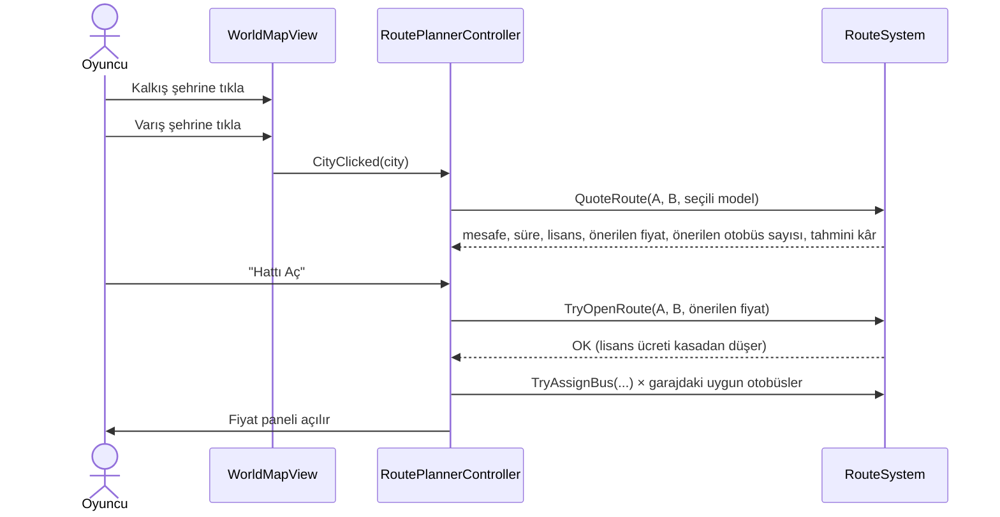

# 2 · Hat Oluşturma ve Talep Esnekliğine Dayalı Gelir Mekaniği

Oyunun kalbi: **hangi iki şehri bağlayacağın** ve **bileti kaça satacağın**.
Bu doküman matematiği adım adım, gerçek sayılarla anlatır. Tüm formüller tek bir saf fonksiyonda toplanır:
`RouteEconomics.Evaluate(...)`. Hem günlük simülasyon hem de UI'daki canlı fiyat önizlemesi **aynı** fonksiyonu
çağırır; oyuncunun gördüğü tahmin ile gerçekleşen sonuç bu yüzden tutarlıdır.

| Dosya | Sorumluluk |
|---|---|
| `Economy/DemandModel.cs` | Talep formülleri (çekim, esneklik, yumuşak kapasite, memnuniyet) |
| `Economy/RouteEconomics.cs` | Bir hattın tek günlük tam dökümü (`RouteForecast`) |
| `Economy/PriceOptimizer.cs` | Kârı maksimize eden fiyatı sayısal bulur |
| `Economy/PricingAdvisor.cs` | Fiyat paneli için eğri, ideal bölge ve renk sınıflandırması |
| `Routes/RouteSystem.cs` | Hat aç/kapat, teklif kartı, fiyat/sefer ayarı, günlük simülasyon |
| `Routes/RouteAdvisor.cs` | Her hat için "en önemli tek sorun + tek tık çözüm" |

---

## 2.1 Hat açma akışı



`RouteSystem.CanOpenRoute` kontrolleri (başarısızlıkta Türkçe mesaj döner, UI butonu pasif yapar):
fiziksel bağlantı (`WorldGraph.CanConnect`) · hat zaten var mı · **hat slotu** (şirket seviyesine bağlı) ·
iki şehrin **bölge lisansı** · lisans ücretine yetecek bakiye.

**Hat lisansı** = `1.000 $ + 5 $ × km` (İstanbul–Ankara 437 km → 3.185 $). Kapatınca iade edilmez —
hat açmak hafife alınacak bir karar olmamalı.

---

## 2.2 Adım 1 — Potansiyel talep: çekim (gravity) modeli

İki şehir arasındaki yolculuk talebi, nüfusların çarpımıyla artar, mesafeyle (belli bir noktadan sonra) azalır:

```
Q_pot = K × (Nüfus_A[mn] × Nüfus_B[mn])^α × f(d) × turizm
```

| Sembol | Varsayılan | Anlamı |
|---|---|---|
| `K` | 60 | Talep ölçeği (`EconomyConfig.demandScale`) |
| `α` | 0.5 | 0.5 → iki nüfusun geometrik ortalaması |
| `f(d)` | AnimationCurve | Mesafe eğrisi (aşağıda) |
| `turizm` | iki şehrin ortalaması | Antalya 1.5, Nevşehir 1.45 ... |

**Mesafe eğrisi `f(d)`** — kısa mesafede özel araç/dolmuş, uzun mesafede uçak otobüsle rekabet eder:

| km | 0 | 30 | 100 | 250–600 | 1.000 | 1.500 | 2.500 | 4.000 |
|---|---|---|---|---|---|---|---|---|
| f(d) | 0.10 | 0.35 | 0.80 | **1.00** | 0.70 | 0.40 | 0.15 | 0.05 |

Eğri Inspector'da `AnimationCurve` olarak çizilerek değiştirilebilir.

Sonra **oyuncuya özgü** çarpanlar uygulanır ve *referans talep* `Q_ref` elde edilir:

```
Q_ref = Q_pot × İtibar(r) × Olgunluk(gün) × Konfor(d) × Durak(A, B)

İtibar(r)    = lerp(0.6, 1.6, r/100)                 → r = 30 iken 0.90
Olgunluk(g)  = 0.3 + 0.7 × (1 − e^(−g/10))            → açılış günü 0.30, 10. gün 0.74, 30. gün 0.97
Konfor(d)    = 1                       (d ≤ menzil)
             = e^(−1.5 × (d − menzil)/menzil)  (d > menzil)  → minibüsle 437 km: 0.50
Durak(A, B)  = 1 + ½ × (bonus_A + bonus_B),  bonus = 0,015 × durağın konfor puanı
                                                      → İstanbul'da 8 puanlık geliştirme: hatlarında ×1,06
```

Durak geliştirmeleri (`StationSystem`, 16 geliştirme, 1–3 konfor puanı) yalnız hat işletilen duraklara yapılır; fiyatları
durağın büyüklüğüyle artar (küçük durak ×1 … metropol terminali ×5). Durağın **popülerliği** (0–100, ★) yalnız görseldir
(içerideki kalabalık): %35 şehrin ünü (nüfus, turizm), %50 duraktan geçen günlük yolcu, %15 konfor.

> **Tasarım notu:** Konfor çarpanı, alt segmentin uzun hatlarda işe yaramamasını sağlar ve oyuncuyu
> doğal olarak üst segmente iter (minibüs menzili 300 km, standart otobüs 1.200 km, VIP 2.500 km).

---

## 2.3 Adım 2 — Referans fiyat

"Piyasanın bu hat ve bu araç için normal kabul ettiği fiyat":

```
P_ref = (3 $ + 0,045 $ × km) × Bölge_bilet× × Segment_bilet×
```

Segment çarpanı filonun **koltuk-ağırlıklı ortalamasıdır** (1 VIP + 3 minibüslük hatta yolcu çoğunlukla minibüs deneyimi yaşar):
minibüs ×0.75, midibüs ×0.9, standart ×1.0, konfor ×1.2, VIP ×1.55.

---

## 2.4 Adım 3 — Fiyat esnekliği (oyunun kalbi)

### Seçilen model: yarı-logaritmik (üstel) talep eğrisi

```
Q(P) = Q_ref × e^( −ε_ref × (P / P_ref − 1) )

ε_ref = 1.5 × Segment_esneklik×     (minibüs 1.875 · standart 1.5 · VIP 1.125)
```

Bu eğrinin **nokta esnekliği** fiyatla doğrusal artar:

```
ε(P) = −(dQ/dP) × (P/Q) = ε_ref × P / P_ref
```

Bunun oyun açısından üç güzel sonucu var:

1. **Ucuz bilette yolcu fiyata pek duyarlı değildir** (ε < 1): fiyatı biraz artırmak geliri artırır.
2. **Pahalı bilette çok duyarlıdır** (ε > 1): fiyatı artırmak geliri düşürür.
3. Bu yüzden gelirin **tek ve iç bir tepe noktası** vardır — "ideal fiyat" gerçekten vardır ve bulunabilir:

```
Gelir maksimumu:   ε(P) = 1   →   P_gelir = P_ref / ε_ref
Kâr maksimumu (Lerner):  (P − c)/P = 1/ε(P)   →   P* = c + P_ref / ε_ref
```

Burada `c` = yolcu başına marjinal maliyet (sefer maliyeti / dolu koltuk + ikram).

> **Neden klasik sabit esneklik (`Q = Q_ref × (P/P_ref)^−ε`) değil?** Sabit esneklikte ε > 1 ise fiyat düştükçe
> gelir **sonsuza** gider, ε < 1 ise fiyat arttıkça gelir sonsuza gider — iç optimum yoktur, oyuncu ya hep
> en ucuz ya hep en pahalı fiyatı seçer. Yarı-logaritmik model "çok ucuz da kötü, çok pahalı da kötü" kuralını
> matematiksel olarak garanti eder. (Doğrulama: `DemandModelTests.Revenue_HasSingleInteriorMaximum...`)

---

## 2.5 Adım 4 — Kapasite ve sefer planı

Her otobüsün günde yapabileceği **tek yön** sefer sayısı:

```
çevrim (saat)   = km / ortalama_hız + 0,5 (indirme/bindirme)
sefer/gün       = 18 saat işletme / çevrim                     (kesirli, günlük ortalama)
koltuk/gün      = koltuk × sefer/gün
```

**Otomatik sefer planı** (varsayılan, oyuncuyu boğmamak için): sistem sefer sayısını talebe göre ayarlar,
hedef doluluk %85'tir. Kullanım oranı `u`:

```
u = clamp( Q / (0,85 × Σ koltuk/gün),  min = 2 sefer/gün,  max = 1 )
```

Böylece talep düşükken boş sefer yapılmaz (değişken maliyet `u` ile ölçeklenir); otobüsler yetersizse `u = 1`
olur ve kapasite **bağlayıcı** hale gelir. Gelişmiş oyuncu bunu kapatıp sefer oranını elle girebilir.

**Taşınan yolcu — yumuşak minimum:** Günlük dalgalanma nedeniyle kapasiteye yaklaşınca bazı günler otobüs dolar,
bazı yolcular yer bulamaz. Bu, keskin `min(Q, C)` yerine yumuşak bir formülle modellenir:

```
yolcu = (Q^−n + C^−n)^(−1/n)        n = 8
Q = C iken yolcu = 0,917 × C      (doluluk %100'e asimptotik yaklaşır)
```

`Q − yolcu` = **kaçan yolcu**. UI bunu "Kapasite yetersiz: günde ~120 yolcu kaçıyor → [Otobüs ekle]" olarak gösterir.

---

## 2.6 Adım 5 — Gelir ve gider

```
Gelir = yolcu × P

Sefer başı gider (otobüs başına, u ile ölçeklenir):
  Yakıt     = km × L/100km ÷ 100 × 1,30 $/L × bölge_yakıt×
  Şoför     = şoför_sayısı × çevrim_saati × 8 $/sa × bölge_maaş×   (9 saati aşan seferde 2 şoför)
  Bakım     = km × bakım/km × (1 + (1 − durum) × 1,5)              (yıpranmış otobüs pahalıya patlar)
  Otoyol    = km × 0,02 $
  Otogar    = iki şehrin otogar ücretinin ortalaması

Yolcu başı gider:  İkram/servis (minibüs 0,2 $ … VIP 2 $)
Sabit gider:       Sigorta/gün (hattaki her otobüs, arızalı olsa da)

Kâr = Gelir − Σ gider
```

---

## 2.7 Uçtan uca sayısal örnek: İstanbul ⇄ Ankara, Toros 46 (standart otobüs)

Varsayımlar: itibar 30, hat 30 günlük, turizm çarpanı 1, bölge çarpanları 1.

| Adım | Hesap | Sonuç |
|---|---|---|
| Karayolu mesafesi | 349,4 km (Haversine) × 1,25 | **437 km** |
| Potansiyel talep | 60 × √(15,6 × 5,8) × f(437)=1,0 | 570,7 yolcu/gün |
| Referans talep | 570,7 × 0,90 (itibar) × 0,965 (olgunluk) × 1 (konfor) | **Q_ref = 496** |
| Referans fiyat | (3 + 0,045 × 437) × 1,0 | **P_ref = 22,67 $** |
| Esneklik | 1,5 × 1,0 | **ε_ref = 1,5** |
| Sefer | 437/88 = 4,97 sa + 0,5 = 5,47 sa çevrim → 18/5,47 | 3,29 sefer/gün/otobüs = 151 koltuk |
| Sefer gideri | yakıt 159,1 + şoför 43,7 + bakım 52,4 + otoyol 8,7 + otogar 6,8 | **270,7 $/sefer** |
| Marjinal maliyet | 270,7 / (46 × 0,85) + 0,5 ikram | c ≈ 7,42 $/yolcu |
| Lerner optimumu | 7,42 + 22,67 / 1,5 | **P\* ≈ 22,5 $** |

**4 otobüsle fiyat tablosu** (`RouteEconomics.Evaluate` çıktısı):

| Bilet | ε(P) | Talep | Yolcu | Doluluk | Gelir | Gider | **Kâr/gün** | |
|---:|---:|---:|---:|---:|---:|---:|---:|---|
| 10 $ | 0,66 | 1.146 | 605 | %100 | 6.055 | 3.969 | 2.086 | 🔴 Çok ucuz: otobüsler tıklım tıklım, 540 yolcu kaçıyor |
| 15 $ | 0,99 | 823 | 600 | %99 | 8.996 | 3.966 | 5.029 | 🟠 |
| 20 $ | 1,32 | 591 | 549 | %91 | 10.972 | 3.941 | 7.031 | 🟢 |
| **21,4 $** | 1,42 | 538 | 516 | %85 | 11.068 | 3.925 | **7.143** | 🟢 **Optimum** |
| 25 $ | 1,65 | 425 | 412 | %82 | 10.304 | 3.247 | 7.057 | 🟢 |
| 30 $ | 1,99 | 305 | 296 | %82 | 8.881 | 2.361 | 6.521 | 🟡 |
| 40 $ | 2,65 | 157 | 153 | %82 | 6.109 | 1.266 | 4.843 | 🟠 Çok pahalı: yolcu kaçıyor |
| 50 $ | 3,31 | 81 | 79 | %82 | 3.940 | 702 | 3.238 | 🔴 |

Lerner formülü (22,5 $) ile sayısal optimum (21,4 $) arasındaki küçük fark yumuşak kapasite modelinden gelir:
4 otobüs tam sınırda çalışırken biraz daha fazla talep, doluluğu %82'den %85'e çıkarır. Kâr eğrisi 20–25 $ arasında
neredeyse düzdür; fiyat panelinin tek bir nokta yerine **"ideal bölge" bandı** göstermesinin sebebi budur.

**Aynı hat, sadece 2 otobüsle:** optimum **30,2 $**'a çıkar (kâr 6.392 $/gün). Kapasite kıt olduğunda
fiyatı artırıp kıt koltukları en çok ödeyene satmak doğrudur. 22,7 $'da kalmak kârı 4.876 $'a düşürür.

> **Oyuncuya öğretilen ders:** İdeal fiyat sabit değildir. Filo büyüdükçe optimum fiyat **düşer**, otobüs
> eksildikçe/arızalandıkça **yükselir**. Üst segment araç referans fiyatı ve esnekliği değiştirdiği için
> yükseltmeden sonra fiyat yeniden ayarlanmalıdır. Bu, oyuncuyu fiyat paneline düzenli olarak geri getirir.

---

## 2.8 Memnuniyet → İtibar geri besleme döngüsü

Kısa vadeli kâr ile uzun vadeli talep arasında bilinçli bir gerilim vardır:

```
Memnuniyet = 0,35 + 0,45 × konfor − 0,40 × (P/P_ref − 1) − 0,30 × kaçan_oranı      (0..1'e kırpılır)
İtibar     ← İtibar + (Memnuniyet × 100 − İtibar) × 0,02        (her gün, yolcu-ağırlıklı)
```

* Referansın %50 üstünde fiyat → memnuniyet −0,20 → itibar yavaşça düşer → **tüm hatlarda** talep düşer.
* Konforlu araç aynı fiyata daha yüksek memnuniyet getirir → itibar artar → VIP gibi itibar kilitli modeller açılır.
* Sürekli yer bulamayan yolcular (kapasite yetersizliği) da memnuniyeti düşürür.

---

## 2.9 Pazar araştırması: fiyatın "sis perdesi"

Önerilen fiyatı kusursuz göstermek oyunun beceri kısmını öldürür. Bu yüzden UI'daki tahminler
**yanlı bir esneklik** ile hesaplanır:

```
ε_tahmin = ε_gerçek × (1 + hata × s)       s ∈ [−1, 1], şehir çiftinden deterministik (FNV-1a hash)
hata     = %20 (Sv.1–3) → %12 (Sv.4) → %6 (Sv.8) → %0 (Sv.12)
```

* `s` şehir çiftinden türetildiği için kaydırıcı oynatılırken tahmin titremez ve teklif kartı ile fiyat paneli tutarlıdır.
* Gerçek simülasyon her zaman doğru esnekliği kullanır. Fiyat panelindeki **"Dün: 412 yolcu · %82 · 7.057 $"**
  satırı oyuncunun tahmin ile gerçeği karşılaştırıp öğrenmesini sağlar.
* İlerleme hissi: seviye atladıkça "pazar araştırması" gelişir, tahminler isabetlenir.

---

## 2.10 Fiyat panelinin renk bölgeleri (`PricingAnalysis.Classify`)

| Bölge | Koşul (tahmini kâra göre) | Renk |
|---|---|---|
| Zarar | kâr < 0 | 🔴 |
| İdeal | kâr ≥ en iyi kârın %95'i | 🟢 |
| Makul | ≥ %80 | 🟡 |
| Çok ucuz / Çok pahalı | < %80, optimumun solunda / sağında | 🟠 |

---

## 2.11 Denge (balancing) rehberi

Tüm sayılar `EconomyConfig` asset'indedir; kod değişmeden ayarlanır.

| İstediğiniz etki | Ayarlanacak alan |
|---|---|
| Genel talep / büyüme hızı | `demandScale` (K) |
| Büyük şehirlerin küçüklere üstünlüğü | `populationExponent` (α ↑ → metropoller daha baskın) |
| Kısa/uzun hat dengesi | `distanceDemandCurve` |
| İdeal fiyat referansa göre nerede? | `baseElasticity` (↑ → optimum referansa yaklaşır/altına iner) |
| Lüks segmentin fiyat avantajı | Model `fareMultiplier`, `elasticityMultiplier` |
| Yeni hattın ısınma süresi | `routeRampUpDays`, `newRouteDemandFactor` |
| Doluluk hissi (sert/yumuşak kapasite) | `capacitySmoothness` |
| Pahalı fiyatın itibar cezası | `satisfactionPriceWeight`, `reputationAdjustRate` |
| Rastgelelik | `dailyDemandNoise` |
| Kârlılık | `fuelPricePerLiter`, `driverWagePerHour`, `tollPerKm`, `farePerKm` |

**Doğrulama:** `Tests/EditMode/DemandModelTests.cs` analitik Lerner optimumunun sayısal optimizerla
eşleştiğini, talebin fiyatla monoton azaldığını ve gelirin tek iç tepe noktası olduğunu test eder.
