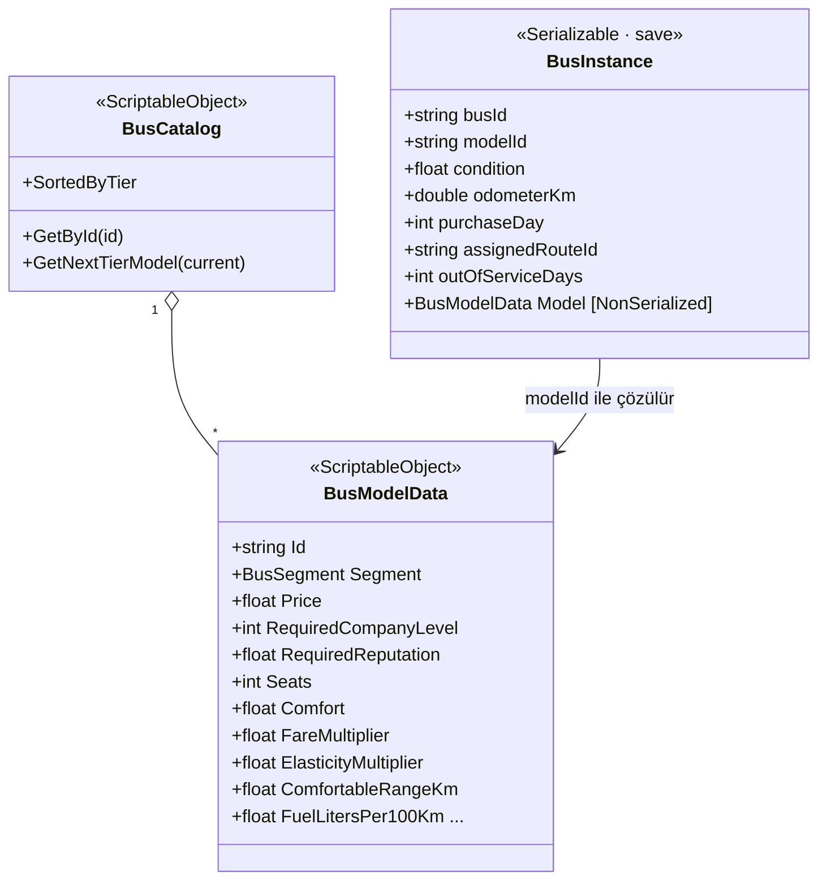
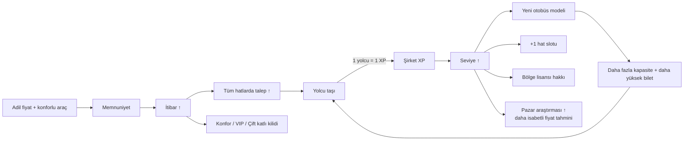

# 3 · Otobüs Satın Alma ve Segment Progression Sistemi

| Dosya | Sorumluluk |
|---|---|
| `Data/BusModelData.cs` | Model tasarım verisi + `BusSegment` enum'u (kademe = sıra) |
| `Data/BusCatalog.cs` | Tüm modeller; kademe/fiyat sıralı liste, "sonraki kademe" sorgusu |
| `Data/ProgressionConfig.cs` | Başlangıç koşulları, seviye eğrisi, hat slotları, pazar araştırması |
| `Fleet/BusInstance.cs` | Oyuncunun sahip olduğu tek otobüs (save'e yazılır) |
| `Fleet/FleetSystem.cs` | Satın al (sıfır/2. el), sat, takasla yükselt, ata, yıpranma, arıza, revizyon |
| `Progression/ProgressionSystem.cs` | XP → seviye, memnuniyet → itibar, kilitler ve "YENİ" bildirimleri |
| `Editor/DefaultContentCreator.cs` | Aşağıdaki 8 modeli asset olarak üretir |

---

## 3.1 Veri modeli: model (SO) ↔ örnek (instance)

* Aynı modelden 50 otobüs = 1 asset + 50 hafif `BusInstance`.
* Otobüs–hat ataması **yalnızca** `BusInstance.assignedRouteId` alanında tutulur (tek doğruluk kaynağı;
  rota ile otobüs listesi senkron dışı kalamaz).
* Kayıt yüklendiğinde `FleetSystem.ResolveModels()` her örneğin `Model` referansını katalogdan bağlar.

---

## 3.2 Segmentler ve modeller (varsayılan içerik)

| Kademe | Model | Fiyat | Seviye | İtibar | Koltuk | Konfor | Hız | Rahat menzil | Bilet× | Esneklik× | Yakıt L/100 | Sigorta/gün | İkram/yolcu |
|---|---|---:|---:|---:|---:|---:|---:|---:|---:|---:|---:|---:|---:|
| 0 Minibüs | Kartal M16 | 22.000 | 1 | – | 16 | ★☆☆☆☆ | 80 | 300 km | 0,75 | 1,25 | 13 | 6 | 0,2 |
| 0 Minibüs | Kartal M19 Plus | 34.000 | 2 | – | 19 | ★★☆☆☆ | 82 | 350 km | 0,80 | 1,20 | 12 | 7 | 0,25 |
| 1 Midibüs | Anka 27 | 78.000 | 3 | – | 27 | ★★☆☆☆ | 84 | 600 km | 0,90 | 1,10 | 18 | 12 | 0,35 |
| 1 Midibüs | Anka 31 Line | 98.000 | 4 | – | 31 | ★★★☆☆ | 85 | 700 km | 0,92 | 1,05 | 19 | 14 | 0,4 |
| 2 Standart | Toros 46 | 185.000 | 5 | – | 46 | ★★★☆☆ | 88 | 1.200 km | 1,00 | 1,00 | 28 | 25 | 0,5 |
| 3 Konfor | Toros 42 Comfort | 280.000 | 8 | 40 | 42 | ★★★★☆ | 90 | 1.800 km | 1,20 | 0,85 | 30 | 35 | 1,0 |
| 4 Lüks VIP | Zirve VIP 2+1 | 420.000 | 12 | 55 | 33 | ★★★★★ | 90 | 2.500 km | 1,55 | 0,75 | 31 | 50 | 2,0 |
| 5 Çift katlı | Zirve Çift Katlı | 600.000 | 16 | 50 | 72 | ★★★★☆ | 85 | 2.000 km | 1,30 | 0,80 | 38 | 70 | 1,2 |

Her segmentin **farklı bir oyun rolü** vardır; "üst segment her zaman daha iyi" değildir:

| Segment | Güçlü yanı | Zayıf yanı | Nerede kullanılır |
|---|---|---|---|
| Minibüs | Ucuz, küçük talepte bile dolar | Uzun hatta talep çöker (konfor), düşük bilet | 30–250 km, küçük şehir çiftleri |
| Midibüs | Orta talepte verimli | Ölçek ekonomisi yok | Bölgesel hatlar |
| Standart | **Koltuk-km başı en düşük maliyet**, uzun menzil | Küçük talepte boş gider | Ana arterler |
| Konfor / VIP | Yüksek bilet, düşük esneklik (fiyata dayanıklı), itibar artırır | Pahalı, az koltuk, yüksek ikram | Zengin/turistik, uzun hatlar |
| Çift katlı | Dev kapasite | Çok pahalı; ancak çok yoğun hatta kâr eder | İstanbul–Ankara gibi omurgalar |

### Yükseltmenin ekonomisi (İstanbul ⇄ Ankara, 437 km, itibar 30, önerilen fiyat ve otobüs sayısıyla)

| Model | Önerilen bilet | Otobüs | Hat kârı/gün | **Kâr/otobüs/gün** | Geri ödeme |
|---|---:|---:|---:|---:|---:|
| Kartal M16 | 21,6 $ | 4 | 1.295 $ | 324 $ | 68 gün |
| Anka 27 | 21,6 $ | 7 | 5.301 $ | 757 $ | 103 gün |
| Toros 46 | 22,7 $ | 4 | 7.125 $ | 1.781 $ | 104 gün |
| Zirve VIP 2+1 | 44,7 $ | 4 | 10.839 $ | 2.710 $ | 155 gün |

Okuma: Minibüs bu uzun hatta talebin yarısını konfor yüzünden kaybeder (hat toplamı yalnızca 1.295 $).
Standart otobüs aynı hattan **5,5 kat** fazla kazanır. VIP, otobüs başına en yüksek kârı verir ama
pahalı olduğundan geri ödemesi uzundur ve 55 itibar ister (gerçekte o itibarda talep %28 daha yüksek olur).
Küçük hatlarda (ör. Eskişehir–Afyon, ~37 yolcu/gün) ise standart otobüs yarı boş gider; orada midibüs en iyisidir.
**Doğru aracı doğru hatta koymak** progression'ın stratejik katmanıdır.

---

## 3.3 Kilitler: neyle ne açılır?

**Seviye eğrisi:** `XP(L) = 1.500 × (L − 1)^2,2` · **Hat slotu:** `2 + (L − 1)`

| Seviye | Toplam XP (yolcu) | Hat slotu | Açılanlar |
|---:|---:|---:|---|
| 1 | 0 | 2 | Kartal M16, başlangıç bölgesi |
| 2 | 1.500 | 3 | Kartal M19 Plus |
| 3 | 6.892 | 4 | Anka 27 |
| 4 | 16.817 | 5 | Anka 31 Line · Pazar araştırması Sv.1 (±%12) |
| 5 | 31.668 | 6 | **Toros 46 (standart şehirlerarası)** |
| 6 | 51.740 | 7 | Bulgaristan lisansı |
| 7 | 77.272 | 8 | Gürcistan lisansı |
| 8 | 108.469 | 9 | Toros 42 Comfort (+ itibar 40) · Pazar araştırması Sv.2 (±%6) |
| 9 | 145.509 | 10 | Yunanistan lisansı |
| 12 | 293.194 | 13 | Zirve VIP (+ itibar 55) · Pazar araştırması Sv.3 (kesin) |
| 16 | 580.086 | 17 | Zirve Çift Katlı (+ itibar 50) |
| 30 | 2.473.813 | 31 | Maksimum seviye |

Simülasyonda basit bir bot, İstanbul'dan başlayarak standart otobüse ~100. günde (1 gün = 4 sn → ~7 dk),
VIP'ye ~460. günde ulaşıyor. İyi oynayan bir oyuncu daha hızlı ilerler.

`ProgressionSystem.GetLockReason(model)` kilitli kartlarda her zaman **somut bir hedef** gösterir:
*"Şirket seviyesi 5 gerekli (14.851 yolcu daha taşıyın)."* · *"İtibar 55 gerekli (şu an 41)."*

Yeni açılan modeller `CompanyState.announcedModelIds` ile **bir kez** duyurulur (toast + galeride "YENİ" rozeti).
İtibar düşerse itibar kilitli modeller tekrar satın alınamaz ama sahip olunanlar elde kalır.

---

## 3.4 Filo eylemleri ve formüller (`FleetSystem`)

| Eylem | Formül / kural |
|---|---|
| **Sıfır alım** | `fiyat = liste` |
| **2. el alım** (galeride anahtar) | `fiyat = liste × (0,35 + 0,65 × durum)` → durum 0,6 ⇒ %74 fiyat. Ucuz başlangıç, ama bakım ve arıza yüksek |
| **Satış** | `liste × 0,88^yaş(yıl) × (0,35 + 0,65 × durum) × 0,85 (galerici marjı)` |
| **Takasla yükselt** | Eski otobüs satılır + yenisi alınır + **aynı hatta otomatik atanır**; bakiye net fark üzerinden kontrol edilir. Progression'ın tek tık eylemi |
| **Atama** | `RouteSystem.TryAssignBus(busId, routeId)` (null = garaja çek) |
| **Yıpranma** | Her gün `durum −= km / ömür_km` (minibüs 400 B km, standart 1 M km) |
| **Bakım maliyeti** | `bakım/km × (1 + (1 − durum) × 1,5)` → durum 0,4'te bakım %90 pahalı |
| **Arıza** | Günlük olasılık `0,08 × (1 − durum)²`; 1–3 gün servis dışı + `fiyat × %1` tamir |
| **Revizyon** | Durumu 0,9'a çıkarır, bedel `fiyat × 0,3 × (0,9 − durum)` |
| **Otomatik bakım** | Filo panelindeki düğme (`CompanyState.autoMaintenance`). Açıkken gün başında durumu 0,6'nın altındaki otobüsler, en yıpranmış önce, revizyona girer (`FleetSystem.RunAutoMaintenance`); kasada dünkü giderin 2 katı kadar yedek bırakılır, parası yetmeyen sonraki güne kalır |
| **Sigorta** | Garajdaki otobüs de sigorta öder → atıl filo para kaybettirir |

Başlangıçta oyuncuya **hediye 2. el Kartal M16** (durum 0,6) ve 40.000 $ verilir
(`ProgressionConfig.startingBus / startingCash`). "Eski minibüsle başla" fantezisi buradan gelir.

---

## 3.5 Yeni model eklemek (tasarımcı kontrol listesi)

1. `Create ▸ Bus Tycoon ▸ Fleet ▸ Bus Model` → kalıcı `modelId` verin (yayından sonra değiştirmeyin).
2. Segment, fiyat, `requiredCompanyLevel`, gerekirse `requiredReputation` girin.
3. Ekonomi değerlerini aynı kademedeki modellerle kıyaslayın: koltuk-km başı maliyet
   `(yakıt × 1,3 + bakım × 100 + 2 + 100 × 8 / hız) / koltuk` (kuruş/km) üst kademede **düşmeli** veya
   bilet çarpanı **yükselmeli** — aksi halde model anlamsız kalır.
4. `BusCatalog` listesine ekleyin. Kod değişikliği gerekmez; galeri, kilitler ve bildirimler otomatik çalışır.

---

## 3.6 Genişletme fikirleri (iskelet bunlara hazır)

* **Kredi / leasing:** `FinanceSystem`'e `LedgerCategory.LoanInterest` + `CompanyState.loans` listesi.
* **Rakip firmalar:** `RouteEconomics.Inputs`'a `CompetitorPrice` ekleyip talebi pazar payıyla bölmek
  (`pay = e^(−β·P_ben) / Σ e^(−β·P_i)` logit modeli). Mevcut esneklik modeliyle doğal uyumludur.
* **Personel / şoför kalitesi**, **otogar yatırımı** (şehirde terminal açınca otogar ücreti düşer),
  **sezonluk talep** (yaz aylarında turizm çarpanı ×1,4).
* **Çok duraklı hatlar** (A–B–C): `RouteState`'e durak listesi; talep her durak çifti için toplanır.
