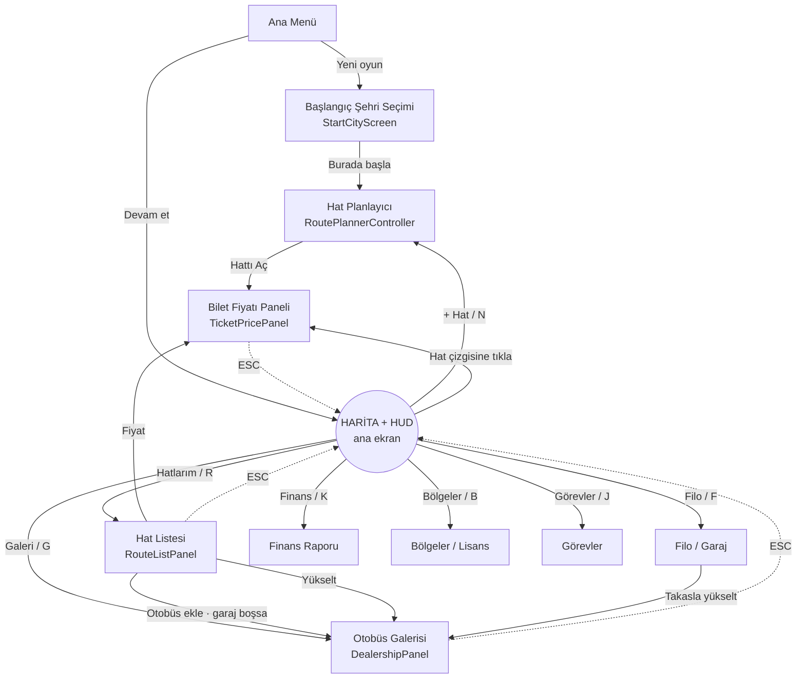

# 4 · UI Akış Planı ve Arayüz Tasarımı

Hedef: oyuncu **hat ve bilet yönetimini** derin menülerde kaybolmadan, haritadan ayrılmadan yapabilmeli.
Tycoon oyunlarının en büyük sorunu "tablo yorgunluğu"dur; bu tasarım her ekranda **tek bir karara** odaklanır.

---

## 4.1 Tasarım ilkeleri

| # | İlke | Uygulama |
|---|---|---|
| 1 | **Harita = ana ekran** | Tüm akışlar haritadan başlar ve haritaya döner. Paneller haritayı kapatmaz, yandan açılır. |
| 2 | **Aynı anda tek panel** | `UIFlowController` tek yan panel gösterir; pencere yığını yok. ESC her zaman bir adım geri, sonunda temiz harita. |
| 3 | **3 tık kuralı** | Hat açmak: kalkış → varış → "Hattı Aç". Fiyat değiştirmek: kart → kaydır → "Uygula". |
| 4 | **Sayı değil, karar göster** | Her hat kartında 20 metrik yerine `RouteAdvisor`'ün **tek** önerisi + tek tık çözüm butonu. |
| 5 | **Önce önizle, sonra uygula** | Fiyat kaydırıcısı canlı tahmin gösterir; "Uygula"ya basmadan hiçbir şey değişmez; "Geri al" hep orada. |
| 6 | **Aşamalı açılım** | Otomatik sefer planı varsayılan; manuel sefer oranı "Gelişmiş" altında. Yeni özellikler seviyeyle açılır. |
| 7 | **Renk + ikon, asla yalnız renk** | Yeşil/sarı/turuncu/kırmızı her zaman bir ikon ve metinle birlikte (renk körlüğü). |

---

## 4.2 Ekran haritası



Kesik çizgi: ESC/Geri. `UIScreenId.None` = yalnızca harita + HUD.
**Oynanabilir sürümde** bu akışın tamamı `BusTycoon.Game/UI/GameUI` (IMGUI) içinde uygulanmıştır — filo, finans,
bölgeler, görevler, günlük ve yardım ekranları dahil. Hat çizgisine tıklama ekran uzayında yapılır (`WorldRenderer.TryPickRoute`).
`BusTycoon.Presentation` altındaki uGUI scriptleri aynı akışın prefab tabanlı alternatifidir.

---

## 4.3 Ana ekran (harita + HUD)

```
┌──────────────────────────────────────────────────────────────────────────────────────┐
│ 🚌 Anadolu Turizm   💰 $48,2 B  (+$1.240 dün)   ⭐ Sv.4 ▓▓▓▓▓░░░  😊 İtibar 42   🛣 Hat 4/5 │
│                                          Yıl 1 · Ay 3 · Gün 12  ▓▓▓░░  [⏸][1×][2×][4×] │
├──────────────────────────────────────────────────────────────────────────────────────┤
│                                                                                      │
│        ● Edirne                                                                      │
│              ● Tekirdağ          ● Kocaeli                                           │
│                  ◉ İSTANBUL ═════════════╗                 ● Samsun                  │
│                     ║  ╲                 ╚═══════ ◉ ANKARA                           │
│                     ║   ╲___ ● Bursa             (yeşil = kârlı)                     │
│            ● İzmir ═╝         ╲                                                      │
│                                ● Eskişehir                                           │
│                                                              [🔍 zoom]  [🌍 bölgeler]  │
├──────────────────────────────────────────────────────────────────────────────────────┤
│ [+ Hat]  [📋 Hatlarım ⚠2]  [🏪 Galeri ●YENİ]  [🚍 Filo]  [📈 Finans]                     │
│ ┌ İST⇄ANK  +$7.1B/gün ▓▓▓▓▓▓▓▓░ %85 ✅ ┐ ┌ İST⇄BUR  +$650 ▓▓▓▓▓▓▓▓▓ %99 ⚠ Kapasite ┐ ...  │
└──────────────────────────────────────────────────────────────────────────────────────┘
                                         ▲ Hat tepsisi: en acil sorun solda
```

* **HUD (`HudView`)**: kasa (kısaltılmış biçim + dünkü net, yeşil/kırmızı), seviye ve XP çubuğu, itibar, hat slotu,
  tarih + günün ilerleme çubuğu, hız kontrolleri.
* **Harita (`WorldMapView`)**: hat renkleri kârlılığı gösterir (yeşil > %15 marj, sarı, kırmızı zarar, gri otobüs yok).
  Kilitli bölgelerin şehirleri gri. Hover → küçük bilgi balonu (nüfus, mevcut hatlar).
* **Hat tepsisi**: yatay kaydırılabilir kartlar; dikkat isteyen hatlar başta. Tek bakışta "her şey yolunda mı?"
* **Bildirim (toast)**: üst ortada 4 sn; yalnızca *karar gerektiren* olaylar (aşağıda 4.9).

---

## 4.4 Akış A — Yeni oyun (≤ 60 saniye)

1. **Ana menü → Yeni oyun**
2. **Başlangıç şehri** (`StartCityScreen`): harita açık, şirket adı alanı, şehre tıkla →
   bilgi kartı: nüfus, 450 km içindeki büyük şehirler, *erişilebilir pazar* ve **zorluk etiketi**
   (Kolay / Orta / Zor). → **[Burada Başla]**
3. Oyun 40.000 $ ve hediye 2. el minibüsle başlar, **otomatik olarak Hat Planlayıcı açılır** (ilk görev).

## 4.5 Akış B — Hat açma (3 tık)

```
 1. tık: Kalkış                 2. tık: Varış                      3. tık: Hattı Aç
 ◉ İstanbul (mavi)       →      ◉ İstanbul ╌╌╌╌╌ ◉ Bursa      →     fiyat paneli açılır
 "Varış şehrini seçin"          (önizleme yayı + teklif kartı)
```

**Teklif kartı** (`RoutePlannerController`) — varış şehri değiştikçe anında yeniden hesaplanır:

```
┌─────────────────────────────────────────────┐
│  İstanbul ⇄ Bursa                    [⇄][✕] │
│  114 km · 1 sa 26 dk yolculuk                │
│  ─────────────────────────────────────────  │
│  Araç:  [ Kartal M16 (16 koltuk)      ▼ ]   │
│  Tahmini talep      ~212 yolcu/gün           │
│  Önerilen bilet     $7,30                    │
│  Önerilen           2 × Kartal M16 (garajda 1)│
│  Tahmini kâr        $657/gün                 │
│  Hat lisansı        $1.570                   │
│  ☑ Garajdaki uygun otobüsleri ata            │
│  ─────────────────────────────────────────  │
│           [        HATTI AÇ        ]         │
│  ⚠ Hat limiti dolu (4/4). Seviye atlayın.    │ ← yalnız hata varsa
└─────────────────────────────────────────────┘
```

* Başka bir şehre tıklamak varışı değiştirir → oyuncu birkaç alternatifi saniyeler içinde **karşılaştırır**.
* Kalkışa tekrar tıklamak seçimi sıfırlar. `[⇄]` yönü çevirir.
* Araç açılır menüsü yalnızca açık modelleri listeler; varsayılan, garajda en çok boşta bulunan model.
* Buton pasifse sebebi her zaman kırmızı satırda yazar (`OpResult.Message`).

## 4.6 Akış C — Bilet fiyatı (oyunun kalbi)

```
┌───────────────────────────────────────────────────────────────┐
│  İstanbul ⇄ Ankara · 437 km                               [✕] │
│  Piyasa referansı: $22,67                                      │
│                                                               │
│   Kâr/gün                                                     │
│    ▲          ┌─────── ideal bölge ───────┐                   │
│    │        ╭─┼────────╮                  │                   │
│    │      ╭─╯ │ ▲      │╰──╮              │                   │
│    │    ╭─╯   │ │önerilen   ╰───╮         │                   │
│    │  ╭─╯     │ │       │         ╰────╮                      │
│  0 ┼─────────────────────────────────────────────▶ Bilet $     │
│              ┃ ← seçili fiyat                                  │
│                                                               │
│   [−]  ━━━━━━━━━━━━━●━━━━━━━━━━━━━━━━━━━━━━━  [+]               │
│        $6,80               $22,50               $68,00         │
│                                                               │
│   ┌──────────────┬──────────────┬──────────────┐              │
│   │ 480 yolcu/gün│ Doluluk %82  │ Kâr $7.130   │  +$410/gün ▲  │
│   │              │ ▓▓▓▓▓▓▓▓░░   │ Gelir $10.894│              │
│   └──────────────┴──────────────┴──────────────┘              │
│   🟢 İdeal bölge                                               │
│   Dün ($21,40): 516 yolcu · %85 · kâr $7.143                   │
│   🔎 Pazar araştırması: tahmin ±%12 sapabilir                   │
│                                                               │
│   [Önerilen fiyat]   [Geri al]          [   UYGULA   ]         │
│   ▸ Gelişmiş: ☑ Otomatik sefer planı                           │
└───────────────────────────────────────────────────────────────┘
```

Etkileşim kuralları (`TicketPricePanel`):
* Kaydırıcı **canlı**: her harekette yolcu, doluluk, gelir, kâr ve "mevcut fiyata göre fark" güncellenir.
  Hesap `RouteSystem.CreateEstimator` ile yapılır (simülasyonla aynı fonksiyon, pazar araştırması yanılgısıyla).
* Fiyat adımı: 20 $ altı 0,10 $, üstü 0,50 $ → "gerçekçi" fiyatlar. `[−]`/`[+]` ince ayar içindir.
* Grafik (`UILineGraph`): kâr eğrisi, **ideal bölge bandı** (tahmini en iyi kârın ≥ %95'i), beyaz çizgi seçili fiyat,
  yeşil çizgi önerilen fiyat. Eğri sıfırın altına inen kısım zarar bölgesidir.
* Renkli rozet + metin: 🔴 Zarar · 🟠 Çok ucuz / Çok pahalı · 🟡 Makul · 🟢 İdeal.
* **"Dün" satırı** tahmin ile gerçeği yan yana koyar: oyuncu yanlı tahmini zamanla "okumayı" öğrenir.
* Gün geçtikçe panel kendini yeniler ama oyuncunun seçtiği (henüz uygulanmamış) fiyatı korur.

## 4.7 Akış D — Otobüs al / ata / yükselt

**Galeri** (`DealershipPanel` + `BusModelCardView`): tüm segmentler alttan üste tek listede, kilitliler dahil.

```
┌──────────────────────────────────────────────────────────────────────────────┐
│ Otobüs Galerisi                         💰 $48.200     ☐ 2. el (durum %60)  [✕] │
│ Sıradaki hedef: Toros 46 — Şirket seviyesi 5 gerekli (14.851 yolcu daha)       │
├──────────────────────────────────────────────────────────────────────────────┤
│ ┌───────────────┐ ┌───────────────┐ ┌───────────────┐ ┌───────────────┐      │
│ │ [img]  ●YENİ  │ │ [img]         │ │ [img]         │ │ ░░░ 🔒 ░░░░░  │      │
│ │ Kartal M19    │ │ Anka 27       │ │ Anka 31 Line  │ │ Toros 46      │      │
│ │ Minibüs       │ │ Midibüs       │ │ Midibüs       │ │ Şehirlerarası │      │
│ │ 19 koltuk ★★☆ │ │ 27 koltuk ★★☆ │ │ 31 koltuk ★★★ │ │ 46 koltuk ★★★ │      │
│ │ 350 km menzil │ │ 600 km menzil │ │ 700 km menzil │ │ Seviye 5      │      │
│ │ $34.000 [AL]  │ │ $78.000 [AL]  │ │ $98.000 [—]   │ │ gerekli       │      │
│ └───────────────┘ └───────────────┘ └───────────────┘ └───────────────┘      │
└──────────────────────────────────────────────────────────────────────────────┘
```

* Kilitli kartlar gizlenmez: **"neyi, ne zaman, ne yaparak"** açacağını gösterir (motivasyon).
* Satın alınan otobüs garaja düşer; hat kartındaki **[Otobüs ata]** veya teklif kartındaki onay kutusu ile atanır.
* Filo ekranında her otobüs için: durum çubuğu, km, atandığı hat, satış değeri, **[Takasla yükselt]**
  (eskiyi satar, yenisini alır, aynı hatta atar — tek tık) ve **[Revizyon]**.

## 4.8 Akış E — Günlük döngü: "Her şey yolunda mı?"

`RouteAdvisor.GetTopInsight` her hat için öncelik sırasıyla **tek** bir mesaj üretir (son 3 günün ortalaması):

| Öncelik | Durum | Mesaj | Tek tık çözüm |
|---|---|---|---|
| 🔴 Kritik | Otobüs yok | "Otobüs atanmadı — hat çalışmıyor." | **[Otobüs ata]** → garajdan ata, garaj boşsa galeriye |
| 🔴 Kritik | Zarar | "Zarar ediyor (−$120/gün)." | **[Fiyat]** → fiyat paneli |
| 🟠 Uyarı | Kaçan yolcu > %15 ve doluluk > %80 | "Kapasite yetersiz: günde ~120 yolcu kaçıyor." | **[Otobüs ekle]** |
| 🟠 Uyarı | Doluluk < %45 | "Doluluk düşük (%38). Fiyatı düşürmeyi deneyin." | **[Fiyat]** |
| 🟠 Uyarı | Memnuniyet < 0,35 | "Yolcular memnun değil: fiyat yüksek veya araç konforsuz." | **[Yükselt]** |
| 🟢 Bilgi | — | "Sağlıklı · $7.143/gün" | — |

`RouteListPanel` kartları önce kritik, sonra uyarı, sonra kâra göre sıralar. Böylece 30 hatlı bir şirkette bile
oyuncu yalnızca en üstteki 2–3 karta bakar.

## 4.9 Bildirim politikası (toast)

Bildirim yalnızca **oyuncunun bir karar vermesi gerekiyorsa** veya **ödül** anıysa gösterilir:

| Gösterilir ✅ | Gösterilmez ❌ (yalnızca raporlarda) |
|---|---|
| Seviye atlama (+ yeni hat slotu) | Günlük gelir/gider kalemleri |
| Yeni otobüs modeli açıldı | Her yolcu/sefer |
| Otobüs arızalandı | Küçük itibar değişimleri |
| İlk kez zarar eden hat | Rutin otomatik kayıt |
| İflas uyarısı (kasa eksi) | |

---

## 4.10 İlk 10 dakika (onboarding)

| Adım | Tetik | Oyuncuya gösterilen | Öğrettiği |
|---|---|---|---|
| 1 | Oyun başladı | Planlayıcı açık, büyük şehir yanıp söner: "İlk hattınızı açın" | Hat açma (3 tık) |
| 2 | İlk hat açıldı | Fiyat paneli; kaydırıcıya ok: "Fiyatı oynatın, kârı izleyin" | Esneklik / ideal bölge |
| 3 | 1. gün bitti | Hat kartı vurgulanır: "Dünün sonucu ile tahmini karşılaştırın" | Tahmin ≠ gerçek |
| 4 | İlk "Kapasite yetersiz" | Kart butonu vurgulanır: "Otobüs ekleyin" | Kapasite ↔ fiyat |
| 5 | İkinci otobüs alındı | "Kapasite arttı: ideal fiyat düştü, fiyat panelini açın" | Optimum fiyat hareket eder |
| 6 | Seviye 2 | Galeri rozeti: "Yeni minibüs açıldı" | Progression |
| 7 | Seviye 5 yaklaşırken | "Toros 46 ile uzun hatlar kârlı hale gelir" | Segment rolü |

Oynanabilir sürümde bu rehberlik `GoalTracker` görev zinciriyle verilir: sol altta her zaman "sıradaki görev" ve
ipucu görünür (ilk hat → fiyat ayarı → 2. otobüs → günlük 500 $ → seviye 3 → 4 hat → şehirlerarası otobüs →
itibar 50 → günlük 5.000 $ → yurt dışı → VIP → ilk milyon → günlük 25.000 $ → 10.000.000 $ zafer). Her görev
para ödülü verir.

---

## 4.11 Görsel dil

* **Renkler:** kâr/olumlu `#4CD973`, uyarı `#FFB333`, zarar/kritik `#F24D4D`, nötr gri `#999`, seçim mavisi `#66BFFF`.
* **Sayılar:** her yerde `UIFormat` (tr-TR): `$12.345`, kısaltma `$48,2 B` / `$1,3 Mn`, bilet `$22,50`, `%85`.
* **Tipografi:** **Inter** (Medium gövde, Bold başlık/buton/rozet, ExtraBold kasa; `Tools/make_fonts.py`). Eş
  genişlikli rakamlar (`tnum`) karakter tablosuna işlenir → kaydırıcı oynarken sayılar titremez.
* **Yönetim paneli görünümü (oynanabilir sürüm, `UIStyles`):** kömür grisi paneller (`#1e1e24`), ince açık kenar
  çizgisi ve yumuşak gölge (`GUIStyle.overflow`); turuncu ana buton (`#ff9100`, siyah yazı), yarı saydam ikincil
  butonlar (basınca hafifçe küçülür); parlak yeşil kasa (`#00e676`, hafif parıltı); renkli zeminli durum rozetleri
  (Yolda / Garajda / Arızalı, İyi / Dikkat / Kritik); hap biçimli bildirimler (yeşil = başarı, kırmızı = hata, ikonlu).
* **Gösterge paneli ve menü:** üstte küçük BÜYÜK HARF etiketli istatistik kutuları (ŞİRKET, ŞİRKET KASASI, TARİH,
  İTİBAR, HATLAR, FİLO); masaüstünde solda tam boy, telefonda altta ikonlu menü (ikon üstte, yazı altta; seçili
  öğe turuncu; sorunlu hat sayısı kırmızı rozet). İkonlar Twemoji atlasından (`UIIcons`).
* **Mini harita (sol alt):** harita dokusu, hat çizgileri (renkleri haritadakiyle aynı), hatlarında giden otobüslerin
  model çizimleri (gittikleri yöne bakar), hatlı şehirler, merkez ve kameranın gördüğü alan (yamuk). Tıklayınca ya da
  sürükleyince kamera oraya gider; başlıktaki düğme küçültür. Görev kartı mini haritanın sağındadır.
* **Görseller:** galeride ve filo kartlarında otobüsün yandan çizimi; Bölgeler, ipucu ve yeni oyun ekranında ülke
  bayrakları; finans kalemlerinde, planlayıcıda, görevlerde ve günlükte ikonlar.
* **Otobüs kartları (Filo):** başlık + durum rozeti, ikonlu ayrıntı satırları (📍 hat, 💺 model, 👥 doluluk,
  🔧 durum, 🛣️ km) ve iki ana düğme (garaja çek / revizyon + hatta ata).
* **Hareket:** panel açılış 150 ms kaydırma; değişen sayılarda 300 ms sayaç animasyonu (kâr artışı yeşil yanıp söner).
* **Kısayollar:** `Space` duraklat, `1/2/3` hız, `N` yeni hat, `R` hatlarım, `F` filo, `G` galeri, `K` finans,
  `B` bölgeler, `J` görevler, `L` günlük, `H` yardım, `F5` kaydet, `Esc` geri / menü, `WASD` kaydır, `Q/E` yakınlaştır.

---

## 4.12 Mobil düzen (telefon / tablet)

Oynanabilir arayüz (`GameUI`) çizimi gerçek piksellerle yapar; bir tasarım birimi `u` piksele denk gelir:
masaüstünde ekran yüksekliği 1000 birim, **telefonda 620 birim** (daha büyük yazı ve düğme), tablette 820 birim.
GUI.matrix ölçeklemesi kullanılmaz çünkü IMGUI yazıları büyütülünce bulanıklaşır.

| Öğe | Masaüstü / tablet | Telefon (`compact`) |
|---|---|---|
| Ana menü | solda dikey araç çubuğu | **altta yatay menü çubuğu** (başparmak erişimi) |
| Yan panel | 490 birim | ekranın en fazla %55'i (harita solda dokunulabilir kalır) |
| Görev kutusu | sol alt | panel açıkken gizlenir |
| Hover ipucu | var | yok (dokunmatikte hover olmaz) |
| Kısayol ipuçları "[N]" | var | yok |
| Kaydırma | tekerlek | panel içinde parmakla sürükleme (kaydırıcı üstünde değilse) |
| Yakınlaştırma | tekerlek, Q/E, +/- | iki parmak (pinch) ve ekrandaki +/- |
| Geri | Esc | Android geri tuşu |

Ayrıca: `Screen.safeArea` ile çentik ve ev çubuğu boşlukları, dar ekranlarda (4:3 tablet) daralan üst çubuk sütunları,
iOS'ta "Çıkış" düğmesi gizli (Apple kuralı), arka plana alınınca (`OnApplicationPause`) otomatik kayıt.

## 4.13 Unity sahne kurulumu (yalnızca uGUI/prefab yolu için)

> Oynanabilir sürüm için bu kuruluma **gerek yoktur**: `GameBootstrap` her şeyi Play'de kodla kurar.
> Aşağıdaki hiyerarşi, `BusTycoon.Presentation` scriptleriyle cilalı bir uGUI arayüzü kurmak isteyenler içindir.

```
Scene
├─ GameSession                (GameSession: WorldMapDatabase, EconomyConfig, ProgressionConfig, BusCatalog)
├─ Main Camera                (+ PhysicsRaycaster  ← şehir tıklamaları için ŞART)
├─ EventSystem                (Input System kullanıyorsanız InputSystemUIInputModule)
├─ WorldMap                   (WorldMapView: CityNode prefab, RouteLine prefab)
│  ├─ MapPlane                (harita dokusu; MercatorProjection sınırlarıyla aynı)
│  ├─ Cities
│  └─ Routes
└─ UI Canvas                  (Screen Space Overlay, CanvasScaler: Scale With Screen Size 1920×1080, match 0.5)
   ├─ UIFlowController        (screens listesi, hudRoot)
   ├─ HUD                     (HudView) ← hudRoot
   ├─ Panel_StartCity         (StartCityScreen, isOverlay = false)
   ├─ Panel_RoutePlanner      (RoutePlannerController, isOverlay = true)
   ├─ Panel_Pricing           (TicketPricePanel + UILineGraph)
   ├─ Panel_RouteList         (RouteListPanel + RouteCardView prefab)
   └─ Panel_Dealership        (DealershipPanel + BusModelCardView prefab)
```

* Yan paneller ekranın sağında %30 genişlik; harita sol %70'te tıklanabilir kalır.
* Panellerde arka plan `Image` raycast'i açık olmalı (panele tıklama haritaya sızmasın);
  panel dışı alan raycast'i kapalı kalmalı.

## 4.14 Script eşlemesi

| Ekran / bileşen | Script | Ana bağımlılık |
|---|---|---|
| Ekran akışı, ESC, HUD gizleme | `UIFlowController`, `UIScreen` | — |
| Üst şerit + toast | `HudView` | `Finance`, `Progression`, `Clock` |
| Başlangıç şehri | `StartCityScreen` | `WorldMapView`, `GameSession.StartNewGame` |
| Hat planlayıcı + teklif kartı | `RoutePlannerController` | `RouteSystem.QuoteRoute / TryOpenRoute` |
| Bilet fiyatı paneli | `TicketPricePanel`, `UILineGraph` | `RouteSystem.CreateEstimator / AnalyzePricing` |
| Hat listesi / tepsi | `RouteListPanel`, `RouteCardView` | `RouteAdvisor` |
| Galeri | `DealershipPanel`, `BusModelCardView` | `FleetSystem`, `ProgressionSystem` |
| Biçimlendirme | `UIFormat` | — |

UI Toolkit tercih ederseniz yalnızca bu tablo değişir; tüm veriler (`RouteForecast`, `PricingAnalysis`,
`RouteInsight`, `RouteQuote`) çerçeveden bağımsız saf C# yapılardır.
